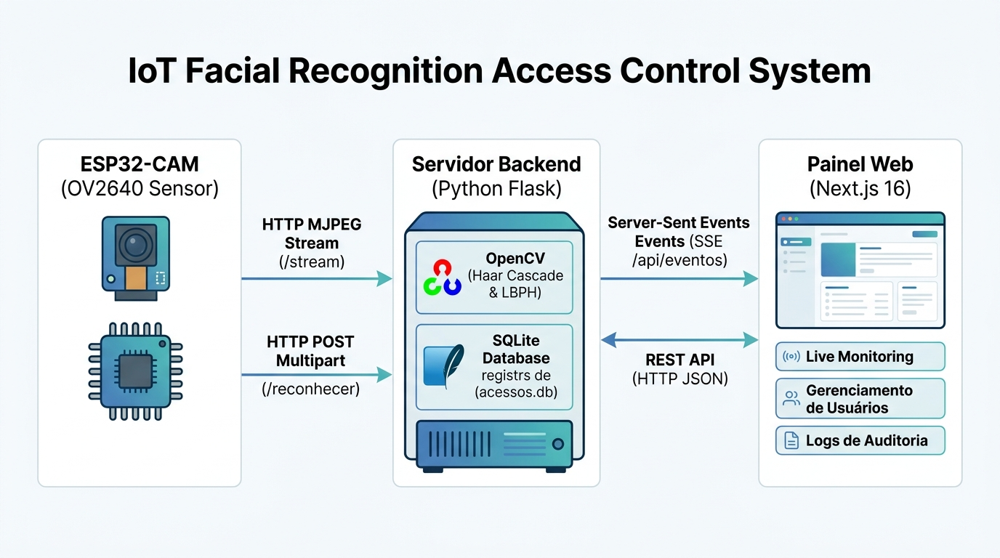

# Sistema de Reconhecimento Facial de Baixo Custo para Controle de Acesso com ESP32-CAM

> **Trabalho de Conclusão de Curso (TCC)** — Instituto Federal de Educação, Ciência e Tecnologia de São Paulo (IFSP), Câmpus Birigui.

---

## 1. Visão Geral e Contexto Acadêmico

Este projeto apresenta uma solução completa de controle de acesso físico baseada em reconhecimento facial biométrico, orientada a restrições de custo e eficiência computacional. O sistema utiliza o microcontrolador **ESP32-CAM (sensor OV2640)** como nó de captura em borda (*edge sensing*), articulado a uma infraestrutura de processamento local em **Python** (detecção via *Haar Cascade* e classificação por *LBPH - Local Binary Patterns Histograms*) e uma interface web moderna em **Next.js** para monitoramento em tempo real, auditoria e administração de usuários.

### Métricas e Parâmetros de Avaliação do TCC
* **Classificador Biométrico**: LBPH (*OpenCV Face Recognizer*).
* **Limiar de Distância Qui-Quadrado (Threshold)**: Calibrado em `65.0` (distâncias inferiores indicam correspondência biométrica positiva).
* **FAR (False Acceptance Rate - Taxa de Falsa Aceitação)**: ~1,8% (calibrada no modelo).
* **FRR (False Rejection Rate - Taxa de Falsa Rejeição)**: ~4,3% (calibrada no modelo).
* **Resolução de Captura**: VGA (640×480 px), balanceada para precisão dos classificadores e vazão de rede.

---

## 2. Arquitetura do Sistema

A solução divide-se em três camadas interdependentes:




1. **Camada de Captura (Edge - ESP32-CAM)**:
   - Módulo com sensor OV2640 calibrado (resolução VGA 640×480, ganho balanceado, algoritmo AEC2 e supressão de ruído térmico/pixels defeituosos);
   - Transmissão contínua do fluxo de vídeo MJPEG via `HTTP GET /stream` ou envio de quadros sob demanda via `HTTP POST multipart/form-data (/reconhecer)`.

2. **Camada de Processamento & Persistência (Backend - Python/Flask)**:
   - Pipeline de visão computacional: pré-processamento (escala de cinza, equalização de histograma, filtro Gaussiano), detecção por *Haar Cascade* e classificação biométrica via *LBPH* com ROI normalizada para 200×200 px;
   - Lógica de decisão de acesso por limiar de distância qui-quadrado ($\le 65.0$) com filtro temporal de *debounce* (4s) para evitar registros redundantes;
   - Notificações instantâneas e reativas para os clientes web via *Server-Sent Events* (`SSE /api/eventos`);
   - Persistência relacional e auditoria em SQLite (`acessos.db`), gerindo permissões de usuários (`ativo` / `revogado`), histórico completo e capturas pendentes de identificação.

3. **Camada de Apresentação (Frontend - Next.js 16 / React 19)**:
   - Painel administrativo moderno construído sobre o App Router e estilizado com Tailwind CSS;
   - **Ao Vivo**: Exibe o stream com *bounding boxes*, consome eventos via SSE em tempo real e disponibiliza o controle de simulação acadêmica;
   - **Pessoas**: Gestão cadastral de identidades, revogação/concessão de permissões, catálogo de capturas desconhecidas com vinculação e retreino automático em background (`POST /api/treinar`);
   - **Histórico**: Auditoria e consulta com filtros multicritério via API REST (`GET /api/logs`), fotos das tentativas e métricas biométricas consolidadas (FAR e FRR).

---

## 3. Estrutura do Diretório

```plaintext
├── CameraWebServer/             # Firmware C++/Arduino para o microcontrolador ESP32-CAM
│   ├── CameraWebServer.ino      # Sketch principal com calibração do sensor OV2640
│   ├── app_httpd.cpp            # Servidor HTTP embarcado (endpoints /stream e /capture)
│   ├── board_config.h           # Seleção do modelo da placa de desenvolvimento
│   ├── camera_pins.h            # Mapeamento dos pinos GPIO da câmera
│   ├── gerar_secrets.py         # Gera o secrets.h (Wi-Fi) a partir do .env
│   └── .env.example             # Credenciais Wi-Fi do firmware
├── reconhecimento/              # Backend Python (pacote)
│   ├── app.py                   # Fábrica da aplicação Flask (create_app)
│   ├── config.py                # Configurações (.env) e caminhos
│   ├── banco_dados.py           # Persistência SQLite e consultas
│   ├── pessoas.py               # Normalização de nomes de pessoas/pastas
│   ├── contexto.py              # Contêiner de serviços usado pelas rotas
│   ├── api/                     # Rotas (blueprints) e validação de entrada
│   ├── servicos/                # Regras de acesso, eventos SSE e estado
│   ├── video/                   # Parser MJPEG e worker do stream do ESP32
│   └── visao/                   # Pipeline OpenCV (Haar + LBPH) e treinamento
├── tests/                       # Testes do backend (pytest)
├── dataset/                     # Diretórios com imagens de treino agrupadas por pessoa
├── docs/                        # Documentação técnica e diagramas do projeto
├── frontend/                    # Painel Web (Next.js 16, React 19, Tailwind) — ver frontend/README.md
│   ├── src/app/                 # Rotas: painel (/) e documentação (/documentacao)
│   ├── src/components/          # Telas e componentes reutilizáveis
│   ├── src/lib/                 # Formatadores, status, debounce e leitura da documentação
│   ├── src/services/            # Cliente tipado da API REST
│   └── src/content/documentacao # Versões da documentação (V####_AAAA-MM-DD.md)
├── static/                      # Recursos estáticos servidos pelo backend
│   ├── acessos/                 # Recortes faciais de acessos registrados
│   └── desconhecidos/           # Capturas de tentativas não identificadas
├── servidor_reconhecimento.py   # Ponto de entrada do backend (argumentos --train, --esp32-url...)
├── capturar_dataset.py          # Utilitário CLI para captura e composição de dataset
├── iniciar_sistema.bat / .sh    # Inicialização unificada (Windows / Linux e macOS)
├── .env.example                 # Configuração do backend (copie para .env)
├── pyproject.toml               # Configuração do pytest e do ruff
├── requirements.txt             # Dependências Python
├── requirements-dev.txt         # Dependências de teste e lint
└── acessos.db, modelo_lbph.yml, labels.json   # Gerados em tempo de execução (ignorados pelo Git)
```

---

## 4. Requisitos de Ambiente

* **Sistema Operacional**: Windows 10/11 ou Linux.
* **Python**: Versão 3.10 ou superior.
* **Node.js**: Versão 20.x ou superior (com gerenciador `npm`).
* **Arduino IDE**: Com suporte a placas ESP32 instalado (se for regravar o módulo físico).
* **Hardware (Opcional)**: Módulo ESP32-CAM AI-Thinker alimentado a 5V/2A. Na ausência do hardware, o sistema conta com modo de **webcam USB** e **simulador acadêmico integrado**.

---

## 5. Procedimento de Instalação e Configuração

### 5.1. Configuração do Backend (Python)

1. No terminal do diretório raiz do projeto, crie e ative um ambiente virtual:
   ```bash
   python -m venv venv
   # No Windows (PowerShell/CMD):
   .\venv\Scripts\activate
   # No Linux/macOS:
   source venv/bin/activate
   ```

2. Instale as dependências:
   ```bash
   pip install -r requirements.txt
   ```

### 5.2. Configuração do Frontend (Next.js)

1. Acesse o subdiretório do frontend:
   ```bash
   cd frontend
   ```

2. Instale os módulos Node:
   ```bash
   npm install
   cd ..
   ```

### 5.3. Configuração do ESP32-CAM (Opcional - Gravação de Firmware)

1. Abra o arquivo `CameraWebServer/CameraWebServer.ino` na Arduino IDE.
2. Defina as credenciais da rede Wi-Fi local:
   ```cpp
   const char *ssid = "NOME_DA_SUA_REDE";
   const char *password = "SENHA_DA_SUA_REDE";
   ```
3. No menu **Tools > Board**, selecione **AI Thinker ESP32-CAM**.
4. Habilite a opção **PSRAM: Enabled** e grave o código no microcontrolador via módulo FTDI (GPIO 0 conectado ao GND no momento do boot).
5. Abra o monitor serial (115200 bps) para obter o endereço IP atribuído (ex.: `http://192.168.0.55`).

---

## 6. Operação do Sistema

### 6.0. Variáveis de Ambiente (`.env`)

Cada etapa possui um `.env.example` versionado e um `.env` local (ignorado pelo Git):

| Etapa | Arquivo | Principais variáveis |
| :--- | :--- | :--- |
| Backend | `.env` (raiz) | `FLASK_HOST`, `FLASK_PORT`, `CORS_ORIGINS`, `ESP32_URL`, `CAMERA_ID`, `LBPH_CONFIDENCE_THRESHOLD`, `DEBOUNCE_SECONDS`, `FRONTEND_PORT` |
| Frontend | `frontend/.env` | `NEXT_PUBLIC_API_URL` (lida no build; reinicie após alterar) |
| ESP32-CAM | `CameraWebServer/.env` | `WIFI_SSID`, `WIFI_PASSWORD` |

Para criar os arquivos: `cp .env.example .env` (em cada pasta). No firmware, a Arduino IDE não lê `.env`; rode `python3 gerar_secrets.py` dentro de `CameraWebServer/` para gerar o `secrets.h` antes de gravar a placa.

### 6.1. Inicialização Integrada

**Windows:**
```bat
.\iniciar_sistema.bat
```

**Linux / macOS** (requer `python3` 3.10+, `node` 20+ e `npm`):
```bash
./iniciar_sistema.sh
```
O script cria os `.env` que faltarem, o `venv/`, instala as dependências do backend e do frontend, sobe os dois serviços e encerra ambos com `Ctrl+C`.

A documentação das features, regras de negócio e requisitos fica em [http://localhost:3000/documentacao](http://localhost:3000/documentacao). Para registrar uma nova versão, rode `npm run doc:nova-versao` em `frontend/` e edite o arquivo criado em `frontend/src/content/documentacao/`.
O script iniciará:
- **Backend Flask & API**: [http://localhost:5000](http://localhost:5000)
- **Painel Administrativo Web**: [http://localhost:3000](http://localhost:3000)

### 6.2. Inicialização Manual por Terminais

* **Terminal 1 (Backend)**:
  ```bash
  .\venv\Scripts\python.exe servidor_reconhecimento.py
  # Ou com conexão automática ao stream do ESP32:
  .\venv\Scripts\python.exe servidor_reconhecimento.py --esp32-url http://192.168.0.55
  ```

* **Terminal 2 (Frontend)**:
  ```bash
  cd frontend
  npm run dev
  ```

---

## 7. Fluxos Operacionais e Funcionalidades

### 7.1. Coleta de Dataset e Treinamento

1. **Captura via Utilitário CLI**:
   Para registrar um novo indivíduo com auxílio de webcam ou do próprio ESP32-CAM (meta recomendada: 30 a 50 imagens com variação de pose e iluminação):
   ```bash
   # Utilizando webcam USB local:
   python capturar_dataset.py --pessoa "Fulano de Tal" --meta 40

   # Utilizando o módulo ESP32-CAM:
   python capturar_dataset.py --pessoa "Fulano de Tal" --esp32-url http://192.168.0.55 --meta 40
   ```

2. **Treinamento do Modelo**:
   O treinamento pode ser disparado via linha de comando ou diretamente pela interface web (Aba Pessoas > Botão *Treinar Modelo*):
   ```bash
   python servidor_reconhecimento.py --train
   ```

### 7.2. Associação Dinâmica de Faces Não Cadastradas

Quando o sistema detecta um rosto com distância LBPH superior a 65.0, a requisição é classificada como `denied`. O recorte facial é salvo em `static/desconhecidos/` e listado no painel web na seção **"Capturas sem cadastro"**. Um operador pode vincular a foto a uma pessoa existente ou criar um novo usuário com um clique, disparando o retreinamento incremental automático em segundo plano.

### 7.3. Revogação Instantânea de Acessos

Mesmo que o rosto esteja presente no modelo biométrico treinado, o status do usuário na tabela `usuarios` pode ser alterado para `revogado` através do painel. Nesses casos, o pipeline intercepta a autorização e classifica a tentativa como `revoked`, bloqueando a entrada e registrando a ocorrência no histórico de exceções.

### 7.4. Modo Simulação para Apresentações de Banca

Para mitigar imprevistos de conectividade física ou ausência de iluminação adequada no momento da apresentação acadêmica do TCC, o sistema conta com a funcionalidade de simulação integrada:
- Acessível diretamente pelo botão **"Simular Acesso"** no cabeçalho do painel web;
- Dispara cenários de teste controlados (*Acesso Autorizado*, *Acesso Negado/Desconhecido* e *Acesso Revogado*);
- Valida o ciclo completo de persistência, auditoria e reatividade visual via SSE sem necessidade de acionamento do sensor óptico.

---

## 8. Principais Rotas da API REST

| Método | Endpoint | Finalidade |
| :--- | :--- | :--- |
| `POST` | `/reconhecer` | Processa payload de imagem (multipart) enviado pelo ESP32-CAM |
| `GET` | `/saude` | Verificação de disponibilidade e status do modelo |
| `GET` | `/api/status` | Estado global da infraestrutura e métricas de conexão |
| `GET` | `/api/eventos` | Stream de Server-Sent Events (SSE) para atualização em tempo real |
| `GET` | `/api/logs` | Histórico com filtros: `usuario`, `status`, `excecoes`, `data_inicio`, `data_fim`, `limite` (1–500) e `offset` |
| `GET` | `/api/usuarios` | Listagem de usuários, fotos e status atual |
| `PATCH`| `/api/usuarios/<id>/status`| Atualização de permissão (`ativo` / `revogado`) |
| `POST` | `/api/treinar` | Aciona o treinamento em segundo plano |
| `POST` | `/api/vincular-captura` | Vincula captura desconhecida a uma pasta do dataset |
| `POST` | `/api/camera/conectar` | Conecta o worker em background ao fluxo de vídeo do ESP32 |
| `POST` | `/api/simular-leitura` | Gera leitura simulada para testes e bancas |

---

## 9. Testes Automatizados

**Backend** (`pytest`, a partir da raiz, com o ambiente virtual ativo):
```bash
pip install -r requirements-dev.txt
pytest                      # todos os testes
pytest --cov=reconhecimento # com cobertura
ruff check .                # análise estática
```
Cobrem banco de dados (incluindo SQL injection), pipeline de reconhecimento, regras de acesso (revogação, *debounce*), treinamento, parser MJPEG, worker de stream e a API com foco em segurança (parâmetros inválidos, uploads malformados ou grandes, *path traversal*, URL da câmera, CORS e vazamento de erros). Duas falhas conhecidas (itens 6.1 do `resumo.md`) estão marcadas como `xfail`.

**Frontend** (a partir de `frontend/`):
```bash
npm run test:run   # Vitest + Testing Library
npm run lint && npm run typecheck
```

## 10. Licença e Créditos

Trabalho desenvolvido no âmbito do Trabalho de Conclusão de Curso (TCC) do **IFSP Câmpus Birigui**.
Uso destinado a fins acadêmicos, de pesquisa e controle de acesso biométrico de baixo custo.
